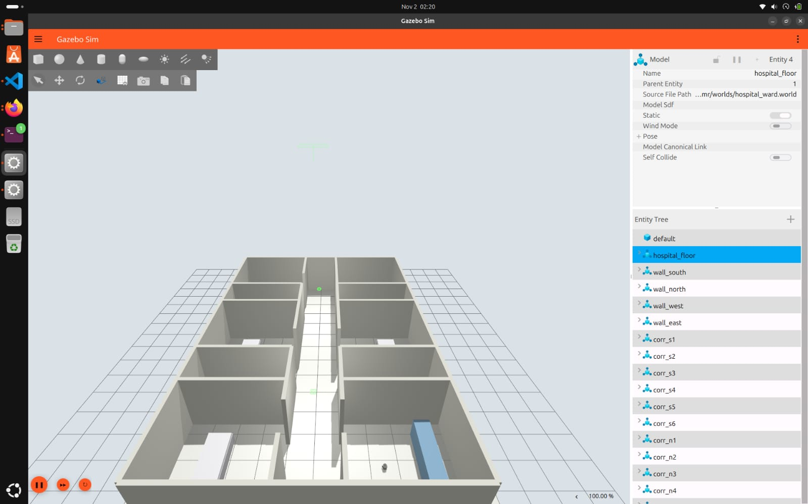
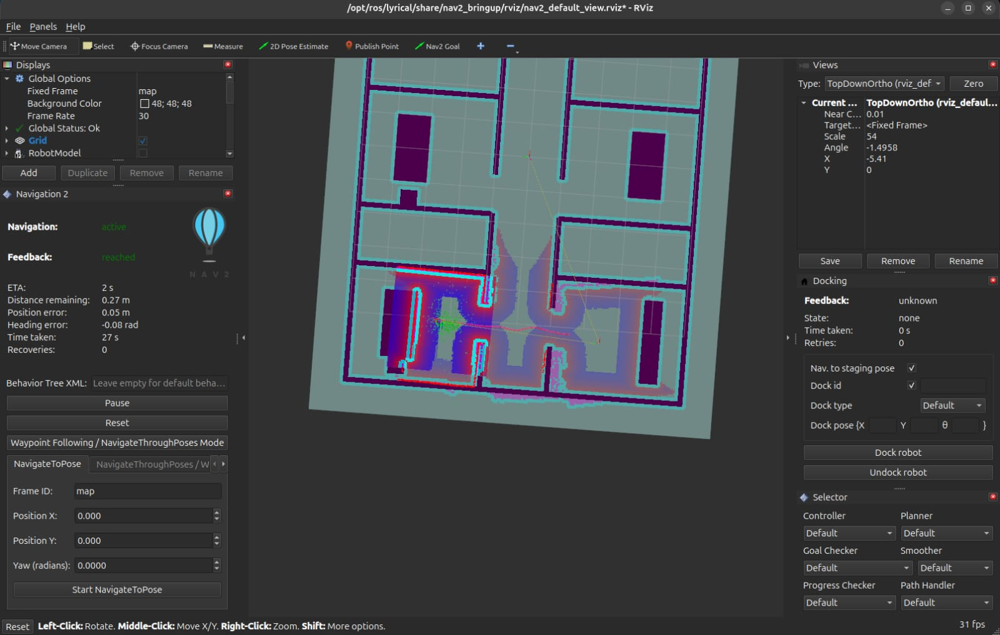
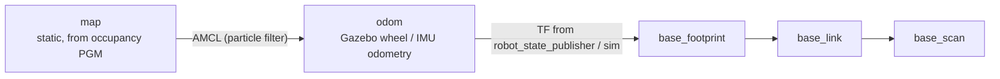
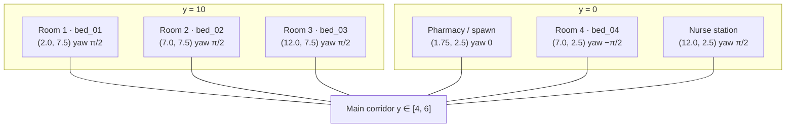
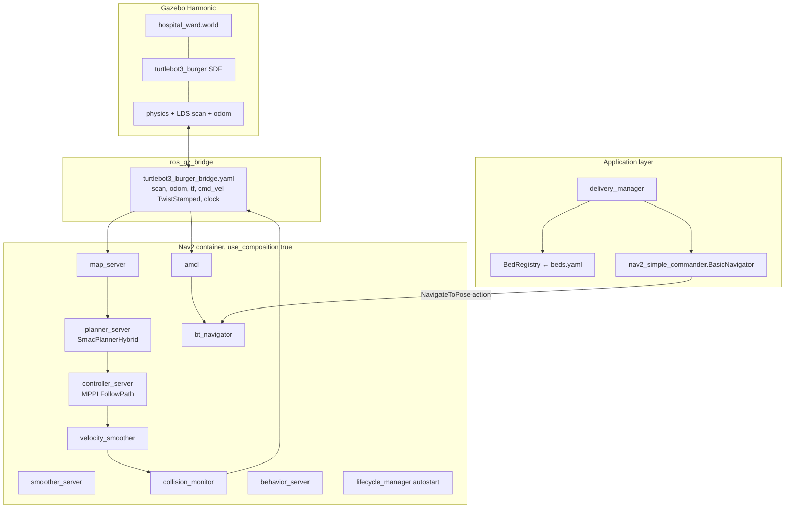
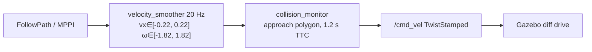
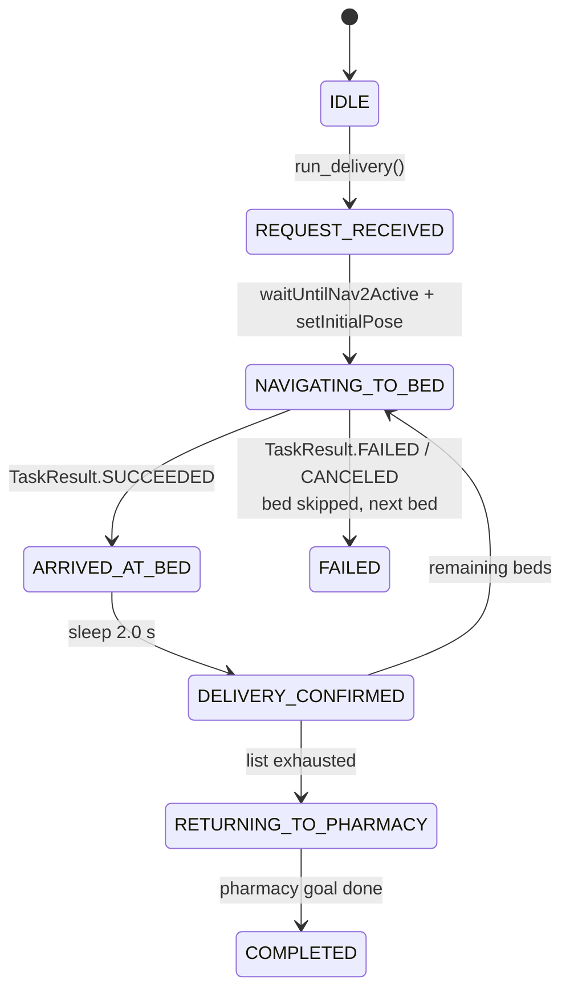

# Medibot: Hospital Medicine Delivery AMR

ROS 2 + Gazebo Harmonic (Lyrical) simulation of an indoor differential-drive AMR that localizes on a static occupancy map, plans hybrid-A* paths through a 14 m × 10 m ward, and executes sequential Nav2 `NavigateToPose` missions from a pharmacy depot to named bed poses.

Platform: **TurtleBot3 Burger**. Command interface is **`geometry_msgs/TwistStamped` on `/cmd_vel`** (Lyrical TB3 `ros_gz` bridge). Plain `Twist` will not move the robot.

---

## 1. Screenshots

### 1.1 Gazebo: hospital ward + spawned Burger



<br/>

### 1.2 RViz: Nav2 (map, AMCL, costmaps, planned path)



---

## 2. Coordinate frames and world geometry

All navigation goals are `PoseStamped` in **`map`**. Gazebo spawn, AMCL initial pose, and the pharmacy waypoint are the same point so localization is consistent at t=0.



| Quantity | Value | Notes |
|---|---|---|
| Ward AABB | \(x \in [0, 14]\), \(y \in [0, 10]\) m | Static SDF boxes, wall thickness 0.15 m, height 2.5 m |
| Corridor band | \(y \in [4.0, 6.0]\) m | Horizontal spine connecting all rooms |
| Door width | 1.2 m | Centered on each room’s corridor wall |
| Occupancy image | `hospital_ward.pgm` P5, **320 × 240**, 8-bit | Row 0 is north (high \(y\)) |
| Map YAML | 0.05 m/px, origin `[-1.0, -1.0, 0.0]` | 1 m unknown border around the building |
| Occupied / free / unknown | 0 / 205 / 128 | `occupied_thresh: 0.65`, `free_thresh: 0.196` |
| Robot spawn | \((1.75,\ 2.5,\ 0.05)\), yaw \(0\) | Pharmacy, facing \(+x\) |
| Burger inscribed radius | 0.105 m | Used as circular footprint on both costmaps |
| LiDAR | LDS-01, ~0.12-3.5 m | AMCL `laser_max_range` clamped to 3.5 m in `nav2_params.yaml` |



Room column bounds used by the world generator:

| Column | \(x_{\min}\) | \(x_{\max}\) | Occupants |
|---|---|---|---|
| 1 | 0.0 | 3.5 | Pharmacy (south), Room 1 (north) |
| 2 | 5.25 | 8.75 | Room 4 (south), Room 2 (north) |
| 3 | 10.5 | 14.0 | Nurse station (south), Room 3 (north) |

Beds, counters, and desks are **static occupied rectangles** in both the SDF world and the PGM so the global planner treats furniture as hard obstacles, not only LiDAR hits.

---

## 3. Runtime architecture

`hospital_sim.launch.py` is the supported bringup. It starts Gazebo server+GUI, `robot_state_publisher`, `ros_gz_sim create` (Burger SDF), the TB3 parameter bridge, Nav2 `bringup_launch.py` in **composition** mode, and RViz.



`hospital_full.launch.py` instantiates each Nav2 node as a standalone process plus an explicit lifecycle manager. `hospital_nav2.launch.py` wraps `nav2_bringup/tb3_simulation_launch.py` and only overrides `world`, `map`, and spawn pose.

**Param file binding**

| Launch | Params file |
|---|---|
| `hospital_sim.launch.py` | `config/nav2_params.yaml` (tuned, `enable_stamped_cmd_vel: true`, AMCL `initial_pose` = pharmacy) |
| `hospital_full.launch.py` | stock `nav2_bringup` `nav2_params.yaml` unless you change the path |
| `hospital_nav2.launch.py` | `config/nav2_hospital_params.yaml` (stock Nav2 defaults; **not** tuned for TwistStamped) |

If `/cmd_vel` is unstamped while the bridge expects `TwistStamped`, the robot will localize but never execute. `nav2_params.yaml` sets `enable_stamped_cmd_vel: true` on `controller_server`, `behavior_server`, and `velocity_smoother`. The alternate `nav2_hospital_params.yaml` does **not** set this flag and uses `NavfnPlanner` instead of `SmacPlannerHybrid`.

---

## 4. Localization

AMCL is a likelihood-field particle filter on `/scan`.

| Parameter | Value | Intent |
|---|---|---|
| `robot_model_type` | `nav2_amcl::DifferentialMotionModel` | Burger kinematics |
| `min_particles` / `max_particles` | 500 / 2000 | Indoor corridor |
| `laser_max_range` / `laser_min_range` | 3.5 / 0.12 m | Match LDS-01 (tuned file) |
| `update_min_d` / `update_min_a` | 0.25 m / 0.2 rad | Limit filter updates while stationary |
| `transform_tolerance` | 1.0 s | Sim + composition jitter |
| `set_initial_pose` | true | Seed at pharmacy in hospital params |
| `recovery_alpha_fast/slow` | 0 | No random particle injection |

`delivery_manager` additionally calls `BasicNavigator.setInitialPose()` at the pharmacy after `waitUntilNav2Active()`, then sleeps 3 s so the filter can converge before the first `goToPose`.

Global costmap frame is **`map`**. Local costmap frame is **`odom`**, rolling 3 m × 3 m at 0.05 m.

---

## 5. Global planning

`planner_server` plugin: **`nav2_smac_planner::SmacPlannerHybrid`**.

| Parameter | Value | Intent |
|---|---|---|
| `motion_model_for_search` | `DUBIN` | Forward-only; no reverse search |
| `minimum_turning_radius` | 0.20 m | Tight indoor turns, still kinematically plausible |
| `allow_unknown` | true | 1 m unknown border + `track_unknown_space` |
| `tolerance` | 0.25 m | Matches controller `xy_goal_tolerance` |
| `max_planning_time` | 5.0 s | Door-narrowing search budget |
| `reverse_penalty` | 2.0 | Prefer forward even if a reverse cusp is generated |
| `rotation_penalty` | 5.0 | Discourage in-place spin in the lattice |
| `cost_penalty` | 2.0 | Stay off inflated cells near beds/walls |

Inflation on **both** costmaps: radius **0.55 m**, `cost_scaling_factor` 3.0. Combined with `robot_radius` 0.105 m this is conservative relative to 1.2 m doors (geometric clearance ≈ 1.2 − 2×0.105 = 0.99 m before inflation). If the planner fails at a door, reduce `inflation_radius` before widening the world.

Smoother: `nav2_smoother::SimpleSmoother`, refinement enabled.

---

## 6. Local control and safety pipeline



**MPPI** (`nav2_mppi_controller::MPPIController`, `motion_model: diff_drive`)

| Limit | Value |
|---|---|
| `vx_max` / `vx_min` | 0.22 / −0.15 m/s (Burger spec) |
| `wz_max` | 1.82 rad/s |
| `ay_max` | 0 (no holonomic slip) |
| `ax_max` | 1.0 m/s² |
| `time_steps` × `model_dt` | 56 × 0.05 s ≈ 2.8 s horizon |
| `batch_size` | 2000 |

Critics: Constraint, Cost (footprint-aware, `collision_cost` 1e6), Goal, GoalAngle, PathAlign (weight 14), PathFollow, PathAngle, PreferForward.

Goal checker: `xy_goal_tolerance` 0.25 m, `yaw_goal_tolerance` 0.25 rad.

**Collision monitor** subscribes to smoothed cmd and `/scan`, action type `approach`, `time_before_collision` 1.2 s. Output topic is `/cmd_vel` (the bridge), not a raw controller topic.

Recovery behaviors on `behavior_server`: `spin`, `backup`, `drive_on_heading`, `wait`. BT XML is the Nav2 default *navigate_to_pose with replanning and recovery*.

---

## 7. Delivery mission

`delivery_manager` is a finite-state client of `NavigateToPose`. It does **not** implement a custom BT; it sequences goals in Python.

ROS parameters:

| Name | Default | Effect |
|---|---|---|
| `bed_id` | `all` | `all` → every key in `beds.yaml`; else one id (`bed_02`, `2`, `Bed 02` all normalize) |
| `mode` | `all` | Same as `bed_id == all` |
| `medicine_id` | `MED-DEFAULT` | Logged only; no payload model |



Lookup: `BedRegistry` loads `beds.yaml` from the package share. Each pose is converted with \(q_z = \sin(\psi/2),\ q_w = \cos(\psi/2)\).

Named poses (map frame):

| ID | \((x, y)\) m | \(\psi\) rad |
|---|---|---|
| pharmacy | 1.75, 2.5 | 0 |
| bed_01 | 2.0, 7.5 | \(+\pi/2\) |
| bed_02 | 7.0, 7.5 | \(+\pi/2\) |
| bed_03 | 12.0, 7.5 | \(+\pi/2\) |
| bed_04 | 7.0, 2.5 | \(-\pi/2\) |
| nurse_station | 12.0, 2.5 | \(+\pi/2\) |

Default tour is beds in YAML insertion order, then pharmacy. Failed beds are skipped; the tour still returns to depot. Each transition is published as `std_msgs/String` on **`/delivery_status`**.

`test_mover` is a Phase-1 open-loop square on `/cmd_vel` (`TwistStamped`) using `/odom` feedback. It does not use Nav2.

---

## 8. Map / world generation

`generate_hospital.py` emits the SDF world and a matching PGM/YAML pair. `generate_map.py` is a standalone PGM writer for the same geometry.

Pixel mapping:

\[
p_x = \left\lfloor \frac{x - x_0}{r} \right\rfloor,\quad
p_y = \left\lfloor \frac{y - y_0}{r} \right\rfloor
\]

with \(r = 0.05\), \((x_0, y_0) = (-1, -1)\). The writer stores rows **bottom-to-top in world Y**, then **flips** so PGM row 0 is \(y_{\max}\). If you edit the PGM in an image tool, do not rotate it; Nav2 origin assumes this convention.

`map_server` is given `yaml_filename` pointing at `maps/hospital_ward.yaml`. The YAML `image:` field is a **sibling filename** (`hospital_ward.pgm`), not a package URI. Both files must stay in the same directory after install (`setup.py` installs `maps/*`).

---

## 9. Build and execution

Distro used in this workspace: **`/opt/ros/lyrical`**.

```bash
source /opt/ros/lyrical/setup.bash
cd /path/to/Medibot
colcon build --packages-select medibot_sim --symlink-install
source install/setup.bash
export TURTLEBOT3_MODEL=burger
```

Kill stale sim graphs before relaunch (Gazebo, RViz, lifecycle nodes, and the parameter bridge fight over `/clock` and `/cmd_vel` if a previous session is still up):

```bash
pkill -9 -f gz; pkill -9 -f ruby; pkill -9 -f rviz
pkill -9 -f ros2; pkill -9 -f nav2; pkill -9 -f parameter_bridge
sleep 3
```

**Terminal 1: physics + Nav2 + RViz**

```bash
source /opt/ros/lyrical/setup.bash
source /path/to/Medibot/install/setup.bash
export TURTLEBOT3_MODEL=burger
ros2 launch medibot_sim hospital_sim.launch.py
```

Wait until AMCL is publishing `map`→`odom` and the global costmap is visible in RViz.

**Terminal 2: mission**

```bash
source /opt/ros/lyrical/setup.bash
source /path/to/Medibot/install/setup.bash
ros2 run medibot_sim delivery_manager
```

Single-bed:

```bash
ros2 run medibot_sim delivery_manager --ros-args -p bed_id:=bed_02 -p medicine_id:=MED-042
```

Open-loop motion check (no Nav2):

```bash
ros2 run medibot_sim test_mover
```

---

## 10. Interfaces

| Direction | Name | Type | Role |
|---|---|---|---|
| in | `/scan` | `sensor_msgs/LaserScan` | AMCL + obstacle layers + collision monitor |
| in | `/odom` | `nav_msgs/Odometry` | local costmap, smoother, AMCL motion |
| in | `/clock` | `rosgraph_msgs/Clock` | `use_sim_time: true` |
| out | `/cmd_vel` | `geometry_msgs/TwistStamped` | last stage of Nav2 → Gazebo |
| out | `/delivery_status` | `std_msgs/String` | mission FSM state name |
| action | `navigate_to_pose` | Nav2 | used by `BasicNavigator.goToPose` |
| TF | `map` → `odom` → `base_footprint` | n/a | AMCL + odom |

---

## 11. Tuning notes

- **Won’t move, AMCL OK:** check `/cmd_vel` type (`TwistStamped`) and that collision monitor is not holding zero.
- **Oscillates in doorways:** `inflation_radius` 0.55 m vs 1.2 m doors; drop toward 0.35-0.45 m or raise `CostCritic` `near_goal_distance`.
- **AMCL jumps after spawn:** confirm spawn, YAML `initial_pose`, and `setInitialPose` all use \((1.75,\ 2.5)\). `nav2_params.yaml` seeds AMCL at origin; `nav2_hospital_params.yaml` seeds at pharmacy.
- **Planner timeout:** Smac Hybrid `allow_unknown` is on; a corrupted PGM (UI chrome, rotation, wrong origin) fills free space with occupied/unknown and exhausts `max_planning_time`.
- **Speeds:** keep `vx_max` ≤ 0.22 and smoother `max_velocity` in lockstep with MPPI or the smoother will clip and MPPI will look unstable.
